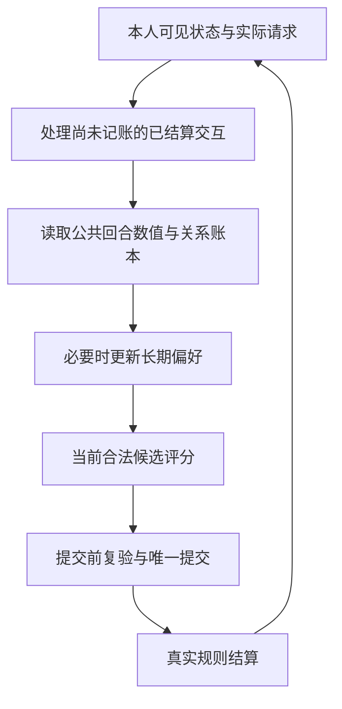

# 分层人机决策与训练实施方案

日期：2026-10-30  
状态：设计稿；本轮更新设计与实施流程，尚未实现人机功能  
适用范围：三人、四人正常对局；基础规则、企业、企业家及 DIY 内容按实际启用的规则与能力合同接入。

本方案采用公共数值模型、长期取舍模型和即时操作模型。公共数值模型提供基础效果、资源和少量特殊标记的回合价值；长期取舍模型在关键节点提供数值修正与角色、企业、样式等选择倾向；即时操作模型对当前合法选项评分。玩家之间已发生的利他、对抗效果以带方向的交互数值保存，用于调整对象选择。

第一版以可解释的数值启发式为主。本文中的“模型”包括表格、公式和参数化规则，不要求神经网络。运行时不复制完整状态执行假设命令，不进行回合内行动序列搜索或跨回合树搜索。原有直接动作价值网络与两层网络训练路线不再是实施前提；本文“训练”主要指离线对局调参与效果验证。

## 一 目标与计算边界

### 三层职责

| 层级 | 负责内容 | 输入与边界 |
| --- | --- | --- |
| 公共数值模型 | 基础效果、回合价格、资源用途修正、特殊标记价值 | 按效果类型、数量、回合和已启用的计分配置查询；不为每张 DIY 卡编写局面分析 |
| 长期取舍模型 | 企业家企业组合、入场样式方向、角色保留与配合倾向、数值修正 | 关键节点读取本人可见信息；输出偏好与失效条件，不输出未来命令序列 |
| 即时操作模型 | 当前选项的收益、支付、对象和合法结束选择 | 使用现有数值与偏好，只评价当前操作；必要历史以玩家交互账本为主 |

阶段选择接口复用上述能力，处理企业家、企业、入场、抉择、盖放、获取与退还角色。它是调用接口，不是第三套规划模型。

### 允许与不要求的计算

- 当前请求的合法性、费用、选择数量、可用次数、目标及当前已知效果来自正式查询。这些是执行事实，不是让卡牌作者编写策略。
- 基础价格不依赖资源是否紧缺、离下一次建设差多少、对手下一步怎样行动。此类判断不放进 DIY 必填数值模型。
- 即时层不搜索下一次独立行动，不预测对手行动、未来抽牌或下回合收益；长期层已给出的修正可作为当前评分输入。
- 支付、选目标、放置等若属于同一次已选择的操作，应保留操作意图和已提交步骤，不能把支付单独当成一次亏损行动。
- 复杂效果若缺少可读取的语义，标记未覆盖，不把未知效果默认为零成本、零副作用或确定可得收益。
- 离线评测运行完整合法对局；这不构成玩家对局时的候选推演，也不能替代正常 UI 验收。

目标是先建立稳定、可解释、能接入常规 DIY 的人机，再用对局证据确认强度。这个结构能够形成各步骤均有评分依据的配合，不保证发现必须先明显亏损、随后多步才能兑现的任意组合。

## 二 现有流程与接入依据

以下为当前代码中与人机有关的流程事实，不替代项目总览的功能交付状态。历史文档中的“企业家未启用”等旧描述不能作为接口依据。

| 流程 | 当前事实 | 接入要求 |
| --- | --- | --- |
| 企业家准备 | 本人先看企业候选预览，企业家按冻结座次的反向顺序选择 | 区分固定座次、企业家选择顺序与当前行动顺序 |
| 企业家选择 | `setup.entrepreneur.choose` 从剩余企业家中选择 | 可评估企业组合，本次只提交企业家 |
| 初始企业 | 各席位独立提交，全部完成后统一公开 | 不读取其他玩家已提交但未公开的答案；三人额外企业未公开前也属于未知信息 |
| 本人企业候选 | 本人投影提供 `OwnEnterpriseCandidates` 等信息 | 不读取房主完整状态中的其他席位候选 |
| 入场 | `entrance.location` 后还有入场事件、初始影响力和角色取舍 | 入场预案在实际子流程结束后修订 |
| 回合准备 | 开始响应后进入 `round.prepare_cover`，按适用条件处理升级、供应补牌、企业家抉择，再盖放 | `RoundStarted` 不等于准备完成；在实际请求与稳定边界更新 |
| 企业家抉择 | `round.entrepreneur.choose` 在第 1、3、5、7 回合出现 | 读取实际候选和牌面身份，不在其他回合虚构选择 |
| 干员特派 | `operator.dispatch.choose` 可接受或放弃，接受后另有 `operator.dispatch.return` | 按实际请求分步选择，取得角色前不写入已拥有集合 |
| 马丁城市化 | 马丁相关效果可选择其他玩家获得城市化 | 当前交互给人机带来的即时净值，直接累计到对应玩家的交互数值 |
| 最终计分 | 矿每个 1 分，铁每 6 个 1 分，碎每 8 个 1 分，土每 9 个 1 分；金券用于平分判胜 | 区分资源用途估计与正式取整结算，不提前把可花资源当作已锁定分数 |

代码入口：

- [企业家流程](../../Assets/YC/Domain/Rules/EntrepreneurFlow.cs)、[本人候选投影](../../Assets/YC/Domain/Rules/EntrepreneurModels.cs)。
- [企业与回合准备](../../Assets/YC/Domain/Rules/ExpansionSetupFlow.cs)、[回合主链](../../Assets/YC/Domain/Rules/RoundExecutionService.cs)。
- [角色获取与退还](../../Assets/YC/Domain/Cards/OperatorDispatchFlow.cs)、[角色生命周期](../../Assets/YC/Domain/Cards/CharacterLifecycleService.cs)。
- [基础效果注册](../../Assets/YC/Domain/Effects/GenericLuaEffectExecutor.cs)、[Effect 合同](../../Assets/YC/Domain/Effects/EffectKernel.cs)。
- [马丁城市化](../../Assets/StreamingAssets/Content/core/lua/entrepreneurs/martin_ability.lua)、[最终计分](../../Assets/YC/Domain/Scoring/FinalScoringService.cs)。
- [玩家可见状态](../../Assets/YC/Domain/State/GameStateView.cs)、[会话入口](../../Assets/YC/Application/Sessions/GameSession.cs)、[命令提交](../../Assets/YC/Presentation/Workflows/CommandGateway.cs)。

## 三 基础数值的来源与维护

### 已给出的参考价格

以下来自本次讨论，用作折算锚点，全部未含转化修正，不代表已经完成平衡校准。文中“土、碎、铁、钱、矿”分别指源岩、源石碎片、异铁、金券、至纯源石。

| 对象 | 参考数值 | 已知规则依据或用途 |
| --- | ---: | --- |
| 1 土 | 3 | 通常出售价格 |
| 1 碎 | 3 | 通常出售价格 |
| 1 铁 | 4 | 通常出售价格 |
| 1 金券 | 1 | 计量单位，通用支付资源 |
| 1 分 | 15 | 当前设计采用的计分折算锚点 |
| 1 矿 | 15 | 通常售价 15，保留到终局每个计 1 分 |

这些价格只说明参考账面关系。不能据此认定出售资源没有价值，也不能认定以较高售价资产换较低售价资产永远亏损。

### 基础效果与行动参考值

以下为用户于 2026-10-30 补充的参考值，均未含转化修正。区间和约数保留原口径，不擅自取中点或改成已经校准的精确值；也不据此假定每回合的实际价值相同。

| 效果或行动 | 参考数值 | 计量口径 |
| --- | ---: | --- |
| 放置 1 枚影响力 | 10 | 一次放置的基础效果 |
| 移除 1 枚影响力 | 10 | 一次移除的基础效果 |
| 替换 1 枚影响力 | 18 | 整体替换，不按移除 10 加放置 10 重算 |
| 移动 1 枚影响力 | 5 | 本轮按影响力移动理解；移动城市另按具体效果估值 |
| 1 次主要行动 | 20 | 一次主要行动的通用参考 |
| 1 次企业升级 | 10 | 升级效果的参考 |
| 1 次企业特效 | 20 | 企业特效的通用参考 |
| 盖放 1 张角色牌 | 25 | 盖放效果的参考，不等同于抽取或获得角色牌 |
| 绿色事件牌收益 | 9—10 | 颜色级整体收益参考 |
| 黄色事件牌收益 | 约 15 | 颜色级整体收益参考 |
| 红色事件牌收益 | 18—21 | 颜色级整体收益参考 |
| 1 次建设 | 约 30 | 平均参考中已考虑宣告分 |
| 各特殊行动、快速行动 | 按具体效果 | 不设统一固定价格 |
| 暂难估值的特殊效果 | 后续倒推 | 保留缺项与估计区间，不直接记为零 |

这些参考包含基础效果与整体行动两个层级。对同一内容采用整体参考或已知效果分解中的一种口径，不重复相加：

- 替换影响力按整体 18 估值时，不再叠加其内部的移除 10 和放置 10；影响力移动的 5 也不再加起点移除和终点放置。
- 建设约 30 是已考虑宣告分的平均预算，不直接计算成“主要行动 20 + 建设 30 + 再加一份宣告分”。即时层展开具体建设时，用已知费用和收益替换对应整体估计，不把平均宣告收益当作每次建设必然取得的分数。
- 事件收益区间用于尚未展开的颜色级参考；选项已知时按该选项的具体效果评价，不把事件预算再加到奖励之上。
- 主要行动 20、企业特效 20、盖放 25 用于对应整体效果的估值；具体结果已纳入评分时不再重复加入同一份整体收益。行动额度的获得、消耗和实际执行收益分别识别，每份只计一次。

### 公共基础效果

建立按效果类型和回合查询的公共表，覆盖获得/支付资源、获得/失去分数、影响力增减、抽取或取得角色、行动机会、已注册状态与卡载标记等。收益和代价使用同一套数值口径。

最小内容字段为效果类型、数量、对象或来源类型、正式时机与限制。常见内容从现有定义读取；特殊卡载标记允许提供一个公共估值定义及回合曲线，不要求设计者填写“本局手牌组合下值多少”。标记的批量兑换或数量规则可以写成简单公式，但不额外扫描地图、库存缺口和对手下一步。

影响力等非货币对象采用公共基础值或少量明确类型值。当前目标是否合法、实际会移除几枚由规则查询决定；未来采集收益、对手后续反应不在基础层逐枚展开。

### 设计预算与操作收益分开

设计卡牌时使用的条件难度折扣、可选性溢价、预计使用次数属于设计预算。当前条件已经满足时，不能再次把实际获得的资源按条件难度折价；多次使用的整张牌预算也不能在每次发动时全部计入。

基础数值由公共配置维护。既有卡牌与常规兑换提供拟合约束，但不能把每张卡都当作严格等价交换。先保留人工可解释初值，再通过完整对局调参；没有足够证据时标记低置信度，不伪造精确最优价格。

### 难估效果的倒推

特殊效果可以在有独立整体预算参考时，用“整体预算减去已知部分”给出初值：

```text
特殊效果的暂定价值 ≈ 整体参考预算 − 已知效果的净价值
```

支付在已知净价值中取负，已经包含的成本或收益不能再扣、再加。采用未含转化修正的整体预算时，已知部分也使用同一口径，避免把转化价值混入特殊效果的基础价。

优先用多张可比较卡牌、同类效果与完整对局结果交叉校准。整体预算是范围时，倒推结果也保留范围；只有约数时标为暂定估计。没有独立预算依据的效果继续保留缺项，不能先假定它的价值再用同一假定反证正确。这个流程用于离线建立公共表，不要求 DIY 作者在运行时分析局面。

## 四 回合基础数值与转化数值

### 转化范围

转化项用于土、碎、铁、金券、分数和矿之间的转换，随转换量变化，可为正、零或负。它表达两种用途变化：通用支付能力，以及计分兑现能力。两种变化可能相互抵消。

资源换钱可能提高通用性，同时降低终局保留价值；分数换钱有失去计分的负向分量，但前期重新获得经营资金可能有正向分量。不能把一种兑换方向永久固定为正收益或负收益。

### 统一估值与拆分展示

对上述资产定义：

```text
b[x, r] = 资产 x 在回合 r 的参考账面单价
c[x, r] = 每 1 账面数值对应的用途修正比例
u[x, r] = b[x, r] × c[x, r]
v[x, r] = b[x, r] + u[x, r]

兑换的基础净收益 B = Σ产出数量 × b − Σ投入数量 × b
兑换的转化修正 C   = Σ产出数量 × u − Σ投入数量 × u
兑换净值           = B + C = Σ资产数量变化 × v
```

第一版先保留上节参考价格作为 `b`，回合中的用途变化主要由 `c` 表达。以后若调整 `b`，应重新校准相应的 `c`，不能把同一项终局价值变化在两处重复加入。

纯获得或失去资产直接用 `v` 计入该操作的回合基础估值，不额外显示“转化奖励”；兑换操作才展示 `B + C` 的拆分。两种记账方式必须得到一致总值。例如直接得到 10 矿，与经过一系列支付最终净得到同样资产，使用相同资产单价，不能因来源不同反复增加用途奖励。`B + C` 和 `Δv` 是两种等价表示，不得三项相加。

这套系数只依赖资产类别、回合及实际启用的计分配置。数学上可合并为一张回合单价表，分开保存是为了让卡牌设计与调参能看清“数量收益”和“用途变化”。它不要求额外的局面搜索。

参数校验要求参考单价非负，普通资产的最终单价非负；在参考单价为正时，默认约束 `c >= −1`。不能通过调参把正常获得资源解释成负收益来人为制造关系反转。若 DIY 明确引入持有惩罚等新机制，使用单独的效果与价值合同，不静默改变普通资源的含义。

### 用户提出的四个例子

下表暂按土碎铁 3、3、4，钱 1，分与矿 15 的参考价格计算，省略回合下标。这里只比较该兑换本身，其他真实费用另计一次。

| 操作 | 基础净收益 B | 转化修正 C |
| --- | ---: | --- |
| 林策略支付 130 金券获得 10 矿 | 20 | `150c矿 − 130c钱` |
| 贸易街区出售 6 铁获得 24 金券 | 0 | `24c钱 − 24c铁` |
| 约翰老妈二级特效以 1 分换 20 金券 | 5 | `20c钱 − 15c分` |
| 某效果以 25 金券换 6 铁 | −1 | `24c铁 − 25c钱` |

林的转化项也可写成 `130(c矿 − c钱) + 20c矿`：前者对应原有 130 数值改变用途，后者对应新增 20 数值也以矿存在。贸易街区的出售即使账面净值为零，也可能有通用性收益。它是否值得建设仍须另算本次建设支付及其他当前效果，不能把出售机会当作免费获得现金。

### 终局边界校准

在已没有任何再投资机会、只比较分数且暂不考虑平分判胜的边界下，可取 `c钱 = −1`、`c分 = c矿 = 0`。对整组 6 铁，参考价值 24，实际计分价值 15，因此该组的修正比例为 `15 / 24 − 1 = −0.375`。

由此可得：25 金券换 6 铁为 `−1 + 16 = 15`；130 金券换 10 矿为 `20 + 130 = 150`；1 分换 20 金券为 `5 − 20 = −15`；6 铁卖 24 金券为 `−15`。这些是边界检验，不是第 8 回合全部时机都直接使用的固定结果。金券的平分判胜用途另作正式终局判定，不能删掉。

日常估值允许按公共单价近似资源的终局潜力；最终取整计分由正式计分服务处理。例如 5 铁与 6 铁实际得分不同，线性基础表不能声称准确处理了所有尾数。需要验证这种近似的损失，但不把库存尾数分析扩成每张 DIY 卡的必填逻辑。

### 一致性约束

- 同回合、同系数、没有其他成本或收益的原路兑换，合计估值必须为零；真实多出或少掉资产时，按净变化计算。
- 拆成多步与合并成一步的同一资产变化，总值应一致；同一收益不能同时作为父操作奖励和子效果奖励。
- 资产售价与终局计分是同一资产的不同用途，不能直接把两者全额相加。
- 矿转为已获得分数时应扣除矿的既有估值；不能再次凭空奖励整份计分价值。
- 启用的 DIY 计分机制若改变资源用途，应使用对应版本的公共表；不把新规则静默套进默认表。

## 五 DIY 接入与卡牌语义

DIY 作者负责声明规则本身：支付、获得、目标、时机、次数、前置条件，以及特殊标记的公共用途。基础效果复用公共数值，新数值组合不要求新增逐卡评分器或重新训练网络。

结构化定义能提供效果时，直接生成估值摘要；复杂 Lua 可提供版本化的效果摘要或特殊标记估值。摘要只用于评分，规则执行与合法性仍以正式接口为准。任意 Lua 的全部条件与后续行为不能假定都能自动静态推导出来。

区分三个支持级别：已完整估值、仅部分效果可估值、新机制尚未接入。合法操作能力与高质量选择能力分别验收。未知收益可以交给明确的基线处理，但必须记录未知范围，不宣称已理解或已保持高难度。

避免给“拥有一张牌”赋整套未来收益后，又在每次使用时重复计入。角色获取、盖放、保留等非常规选择由长期倾向补充；即时层只计本次实际处理的对象与效果。

## 六 长期取舍模型与触发节点

长期模型输出 `StrategicContext`：资源用途的有限修正、企业与样式方向、角色选择与保留倾向、简单配合标签、有效范围和失效条件。第一版使用参数化规则与公共价值表；学习型上层只在以后有明确评测收益时另行接入。

对同一特征，修正价值单价与追加选项奖励二选一，不能重复奖励。长期加项须记录来源和适用对象，不得无限叠加成为永久保留或永久追逐某目标的命令。

| 节点 | 时机 | 更新内容 |
| --- | --- | --- |
| T0 企业家选择前 | 本人企业预览可见，企业家候选就绪 | 企业家与企业组合评分、座次与本局内容适配、对手企业选择情景 |
| T1 企业选择及公开后 | 本人企业请求出现；全体企业公开 | 重新选择本人企业，公开后修订竞争与资源方向 |
| T2 入场前 | 本人合法落点就绪 | 结合公开企业家、企业、座次和先前真实落点，评估入场与样式方向 |
| T2b 入场完成后 | 入场事件及角色取舍等必要流程结束 | 根据实际获得的资源、角色和能力修订预案 |
| T3 回合准备请求前 | 升级、供应选择或企业家抉择可回答 | 更新公共回合参数，对当前准备请求补充偏好 |
| T3b 盖放前 | 相关准备结束，盖放候选就绪 | 角色、抉择与已启用能力的本回合倾向 |
| T4 新角色候选揭示 | 本人看见候选，尚未决定接受 | 获取、拒绝与已知退还成本的阶段评分 |
| T4b 角色集合变化结束 | 获取、退还、回收、永久移除等实际完成 | 更新角色保留与简单配合倾向 |
| T5 关键条件失效 | 目标被拿走、能力改变、既有计划失效 | 默认局部修订，必要时换方向 |
| T6 终局转换 | 进入约定的终局阶段 | 调整经营与计分用途，撤销无法再兑现的保留偏好 |

事件先合并脏标记，到实际请求可回答或子流程稳定边界再计算。同一效果链中的抽牌、获取和退还不能引发无休止完整重评。

玩家交互账本在每次当前交互实际结算后更新，不必等待回合开始，也不因关系数值改变就重新计算全部长期规划。

## 七 阶段选择与长期偏好的范围

### 企业家与企业组合

T0 枚举合法企业家与本人已知企业候选的配对；数量规则来自正式请求。评分使用本局设置、固定座次、公开样式与设施、本人候选和公开对手能力。先答企业家请求，到企业请求时再按最新可见事实选择，不能提前锁定未拥有的企业。

对手隐藏企业构造有限情景，遵守已知排除与正式分配约束；不读取实际隐藏分配或尚未公开的提交。每个本方组合在同一批情景上评分并汇总，不能在各情景里先看隐藏答案再替自己选择最优企业。

输出 `ExpectedScore`、`ScenarioP10 / ScenarioP90`、情景覆盖与估值缺项。它们是统一数值单位下的启发式分数与情景分位范围，不是经过校准的胜率，也不是收益保证或统计置信区间。默认按期望排序，风险倾向另配。

### 入场与样式方向

读取已公开落点，不猜测尚未入场玩家的真实答案。采用公开资源结构、当前路网、座次与能力匹配等轻量指标，维护一个主样式和一个备选方向。字段包括目标身份、少量合法图案方案、缺少条件、当前供应支持和切换条件。

几何匹配遵守正式旋转与占用规则，不把互斥方案同时算成已兑现收益。未出现的未来设施不当作已拥有；入场事件和基础角色取舍结束后修订方向。

### 角色、抉择与配合

长期层可识别有限的角色与能力配合，为盖放、保留、获取、退还提供倾向。只记录方向、前置条件与可用窗口，不列出未来行动序列，也不把倾向加项解释成收益已确定。

基础角色未使用后的回收、一次性角色、持续角色及额外盖放按正式生命周期处理。不能因两张牌文字互补就默认同回合能连续使用。企业升级的解锁价值与实际发动特效分别计入，避免提前计收完整特效。

干员特派在候选阶段比较接受、放弃与已知退还负担，真正出现退还请求时重新读合法候选；新获得的牌是否可退由当前合同决定，不写死。未知后续候选不按最优答案预支收益。

## 八 即时操作评分

### 当前评分构成

```text
选项评分 = 当前操作基础净值
         + 当前兑换的转化修正
         + 长期倾向加项
         + 对象关系加项
         − 尚未计入的行动机会成本
```

资产价值按第四节使用同一口径：纯获得/支付用完整单价；兑换用拆分后的基础与转化项。已经扣过的支付不再次扣除，已经包含的行动额度损失也不再记一遍。

对抗操作除本人变化外，可用公共效果表评价当前明确发生的对方损失，按统一对抗系数计入基础净值。对方私有资产及其未来机会不补全。关系加项只改变对象倾向，不修改规则结果，也不把对方损失同时当成本人的资源获得。

### 当前操作的范围

只读取当前候选和这次操作已知的费用与效果摘要。不执行候选命令，不展开下一次独立行动，不预支未揭示随机结果。已声明的随机效果可用固定分布均值或范围估值，不能查看真实牌堆顺序。

一次建设中的支付、位置选择和确认属于同一操作。`CurrentOperationIntent` 保存操作来源、已选前缀、已知支付与收益摘要；后续比较只区分仍可选择的部分，不能不断重复奖励启动时的预计收益。需要新随机信息时以实际揭示后的请求继续。

必答请求按合法候选完成；只有规则允许时才可放弃、取消或结束。候选组合受数量和顺序约束时分步选择，小集合可枚举当前组合，但不把独立评分拼成非法集合。

### 连续决策与 combo

每次真实结算后重新读取状态、候选及已更新的公共数值与偏好。获取资源、建设、发动新能力可以由连续单步选择形成配合，但每一步必须在当前评分中有依据。

对“先亏损、且准备状态未被估值，后面多次独立操作才收益”的组合，允许第一版漏判。先记录失败类型，检查是否缺少一个可复用的基础效果或标记价值；不因此默认要求所有 DIY 作者补写局面分析，也不把短程搜索改成隐含依赖。

## 九 玩家交互数值与对象选择

### 有方向的交互账本

对人机玩家 i，维护每位其他玩家 j 的累计数值 `Relation[i, j]`，表示“与 j 的交互给 i 带来的即时净值累计”。正数表示净帮助，负数表示净损害，初值为零。`Relation[i, j]` 与 `Relation[j, i]` 独立，不共享私有信息，也不推断真实意图。

必要历史以这个账本为主，不要求保存完整行动序列。关系记忆只需累计值与已处理的结算记录身份；合法可记忆信息和当前操作意图仍由各自接口保存。

三人、四人局中，每个人机的普通对象评分只读取另外 2 位、3 位玩家的累计值，不重新扫描全部历史。实际结算后增量更新账本，不要求额外保存效果来源链或逐次责任记录。

```text
本次交互值 ΔR[i, j]
= 当前与 j 的交互中，i 实际获得与失去对象的公共净值

Relation[i, j] ← Relation[i, j] + ΔR[i, j]
```

使用交互发生回合的公共数值和用途修正，排除长期偏好、关系加项和猜测的未来收益，防止“因为喜欢他，所以同一礼物越记越贵”。同局固定数值配置版本，结算时把即时数值加入累计；后续回合不重新计算历史金额。第一版默认不衰减，累计值保留；若以后需要淡忘，作为独立风格参数验证，不默认加入。

### 记录什么

- 其他玩家实际给予的资源、分数、影响力或已估值权益记正值；实际造成的损失记负值。
- 一个交互同时有获得与支付时，按受影响玩家的完整净变化记账，不只记奖励一侧。
- 城市化按实际完成的基础效果汇总，不仅因为看见“城市化”就先给固定关系奖励；没执行成功的部分不记。
- 多人共同受益时，各人机只记录本人实际知道且受到的影响；不能读取他人的私有收益来完善账本。
- 对手自己得分、买走供应牌、占据潜在目标等，不自动视为对本人造成了同额损害。第一版只记录已定义的直接影响，不模拟“如果他没做我本可以怎样”。
- 效果量对本人不可知或类型尚不能估值时，不猜测金额，按通用估值缺项记录处理。

### 直接记账与最小去重

记账直接使用当前交互已经提供的对方玩家、受影响玩家和实际增减数值。不新增来源归因模块，不追溯父建设、Effect 树或更早的触发者，不划分责任或推断动机。

例如当前交互为马丁玩家让人机获得城市化，本次实际净值为 +30，就直接执行 `Relation[人机, 马丁玩家] += 30`。后续独立操作按各自当前交互记账，不追查是否受更早事件间接影响。

没有玩家间对象的交互不写入这份关系账本，基础收益评分照常进行。多人交互按当前明确的双方分别更新，不建立额外的共同来源或责任分摊模型。

只在实际结算入口记账一次，使用 `GameId + ObserverPlayerId + SettledUpdateId` 或等价的已处理位置去重。UI 刷新、重连和读档不重新累计。若游戏正式回滚，累计值与已处理位置随同一对局快照恢复；不另建来源证据或冲正审计系统。

### 如何影响目标选择

对当前候选 a 的每个直接受影响玩家 j，按公开可计算的当前效果确定作用方向 `s(a,j)`：利他取 +1，对抗取 −1，没有直接净影响取 0。混合效果按公共净值判断，无法判断则不给关系加项。

```text
归一化关系 f(R) = R / (H + |R|)，H > 0
对象关系加项 = clamp(λ × Σ f(Relation[i,j]) × s(a,j) × w(a,j), −L, L)
```

`w` 是由本次直接影响量换算的强度，范围为 0 到 1，默认采用统一规则；`λ`、`H`、总上限 `L` 由全局风格配置提供。默认启用时三者均为正数，`λ=0` 只用于明确关闭关系倾向的对照版本；不得调成负数反转用户要求的方向。不要求逐卡编写好恶逻辑。多人效果的总修正受上限约束，不能只因目标多就得到无限关系奖励。

因此，对移除其他玩家影响力的候选，关系越正，攻击倾向越低；关系越负且最低，攻击倾向越高。对给予收益的候选则相反。初值全零时完全按基础与长期评分选择。

关系是选择倾向，不是免伤协议。基础收益相近时优先避开帮助过自己的玩家；某个目标的实际操作价值明显更高时仍可选择。关系不能让非法目标变合法，不能绕过必答或取消一个规则要求必须完成的效果。

### 马丁示例

假设马丁玩家触发的城市化已经实际给人机带来公共净值 +30；另一位玩家的攻击累计造成 −20，第三位没有交互，账本分别为 +30、−20、0。这些是说明算法的示例数值，不是城市化或影响力的正式定价。

若三个移除候选的基础与长期评分均为 10，示例取 `H=30`、`λ=5`、`w=1` 且总限额未触发，则最终分别为 7.5、12、10：优先攻击负值最低者，优先避开马丁。若移除马丁的基础与长期评分为 20，则其最终为 17.5，仍可能高于其他目标。

这是按已发生互动形成的行为风格，不作为多个人机串通策略，不共享阵营目标。评测应分别报告有无关系倾向时的强度与对象选择变化。

## 十 数据合同与输入

以下为拟新增名称，不表示项目已存在同名实现。

| 合同 | 必要内容 |
| --- | --- |
| `BotObservation` | 游戏、席位、内容与规则版本，本人可见状态、回合阶段、实际请求与缺失标记 |
| `BotCandidate` | 选项身份、动作与目标、数量限制、费用、已知效果摘要、合同引用及估值缺项 |
| `ValueProfile` | 参考价格、回合基础效果表、用途修正、特殊标记定义、计分配置和版本 |
| `StrategicContext` | 触发来源、数值修正、阶段选择倾向、样式方向、角色偏好、有效期和失效条件 |
| `CurrentOperationIntent` | 进行中操作、正式请求、已选步骤、已提交费用、剩余可选内容 |
| `InteractionLedger` | 逐玩家累计正负净值、已处理结算位置或身份、账本版本 |
| `InteractionValueUpdate` | 当前对方玩家、受影响玩家、本次即时净值、发生回合、结算记录身份；直接累计，不保存来源链 |
| `ScoreBreakdown` | 基础、转化、长期、关系、机会成本各项，来源、估值覆盖率及最终分数 |
| `BotDecision` | 原观察与请求、选中候选、配置版本、各评分项、选择概率、耗时和降级原因 |
| `BotEpisodeRecord` | 完整游戏配置、席位策略版本、真实提交结果、终局结果、覆盖与故障记录 |

输入保留地图邻接和位置、城市设施布局、玩家座次、公开能力与本人角色来源区。不能只以 zone 中物品总量代替当前请求与权限，也不把后台所有 zone 直接喂给人机。隐藏手牌、未公开提交与牌堆顺序仍按正式玩家投影隔离。

对象使用稳定玩家 ID 与内容 ID，不以昵称、按钮文字或“马丁”字样做策略特判。显示可关联当前企业家名称，但更换显示名称不改变账本归属。

## 十一 工程接入与恢复

### 模块落点

建议新增 `Assets/YC/AI` 与独立 `YC.AI` 程序集。规则层不依赖 AI，第一版不引入必需的神经推理运行时。

| 模块 | 职责 |
| --- | --- |
| `BotObservationBuilder` | 席位投影、当前窗口与必要记忆 |
| `BotCandidateAdapter` | 当前合法选项、效果摘要与分步操作合同 |
| `ValueProfileService` | 公共回合数值、转化差额与特殊标记估值 |
| `StrategicContextService` | 关键节点、修正与失效处理 |
| `PhaseDecisionService` | 企业家企业、入场、抉择、角色等阶段选择 |
| `InteractionLedgerService` | 按当前交互直接累计即时数值，处理最小去重与快照恢复 |
| `TacticalDecisionService` | 当前评分、关系加项、难度选择 |
| `BotCommandAdapter` | 正式提交、拒绝、过期与幂等 |
| `BotSeatCoordinator` | 唯一控制权、预算、联机与恢复 |
| `BotTraceRecorder` | 决策拆分、评测轨迹和私有证据隔离 |

### 执行顺序



先确认席位控制权，捕获不可变观察与候选。评分期间不持有可写规则对象。提交前复验请求、目标、费用和数量；过期后重新读取并决定，不只改命令 ID 重发旧意图。候选评价不更新关系数值，只有实际结算才更新。

### 联机与存档

第一版由房主侧唯一协调器驱动明确的 Bot 席位，使用正式席位控制者映射。客户端应用已提交命令，不各自重复运行 Bot。房主可读完整状态不等于人机输入可越过玩家投影。

保存 `ValueProfile` 和策略版本、长期上下文、当前操作意图、关系累计值、已处理结算位置、策略随机状态与席位控制权。关系累计值与规则提交位置一起恢复，随后仅处理新增结算；不要求重建来源链，也不能从完整状态补读历史隐藏内容。

同局固定配置版本，回合曲线按已保存配置推进。每局关系从零开始，关系不按人类账号跨局累计，不混入其他席位的私有评价。公共网络状态不广播人机私有账本。

人机随机源与游戏随机源分离。超时使用本次已算完且仍合法的最好候选，其次使用已验证基线；无法确定合法答案时保留故障，不能跳过必答。性能分别测量观察、候选摘要、上层、即时评分、数值累计和提交等待，预算由目标设备实测确定。

## 十二 参数建立、离线调优与训练

### 建立公共模型

1. 固定本次资源、基础效果和整体行动参考表的版本，保留区间与约数，列出尚无价格的特殊效果及标记。
2. 从常规获取、支付、兑换和设计预算中整理约束，分开记录行动成本、条件和使用次数。
3. 先校准终局边界与往返兑换一致性，再给前中期用途系数设置可解释初值。
4. 为已注册效果建立通用摘要与覆盖清单。未知机制先声明缺口，不靠逐卡大段策略填补。
5. 建立固定样例回归，包括本次四种兑换、直接获得与兑换获得的一致估值、整体行动与子效果不重复计值，以及关系的正负方向。

### 公共数值与另外两层分开调整

先固定参考价格，调整用途修正和其他基础效果参数，不同时放开参考价与用途系数去解释同一最终单价。回合曲线可先设置前、中、后期少量控制点，再插值；正式终局规则确定的边界与日常近似分开验证。

固定长期与即时选择的简单版本，比较不同公共参数表在多局中的表现；再固定公共表，让长期取舍与即时选择使用实际终局分数训练各自允许的参数和倾向。按版本交替迭代，不让三层同时任意变化、互相抵消。

终局分数是训练与调参结果，不是给每一步操作直接贴上的价值标签。仍需同时报告胜率、名次或相对得分，检查仅增加自身得分是否遗漏了有效对抗。即时层训练后继续遵守当前操作范围，学习参数不等于增加在线未来行动搜索。

### 离线对局流程

训练和评测环境复用现有 C#、Lua、正式命令和效果执行器，不在 Python 或 AI 模块中重写规则。多进程训练前验证内容缓存、Lua、随机与临时状态隔离。离线运行可无 Unity 画面，但不是正常 UI 验收。

先运行合法随机与固定数值基线，再分别加入回合用途修正、长期倾向、关系账本，比较每项作用。调参优先调整少量公共系数与曲线，按模块分阶段进行；第一版无需采集完整状态去训练直接动作网络。

以实际胜负、名次和得分分布衡量竞技效果，另报告运行稳定性、DIY 覆盖和关系行为。不能用自身评分更高、报复次数更多或更服从长期计划当作变强的证据。关系风格参数单独保留，避免调胜率时无声删除用户要求的互动倾向。

对手池包含不同风格基线、历史参数版本和不同难度，轮换座次、地图与内容组合。按完整游戏划分调参集与独立测试集，并留出未参与调参的 DIY 数值变体和效果组合。没有测试过的新机制不自动继承高难度结论。

隔离算法实验可使用记录完整的种子与合法初始化配置配对比较，不回写真实游戏。多局统计包含置信范围；对称自博弈平均胜率约为 `1 / 人数`，不能单靠它证明进步，也不把三四人结果直接当作双人 Elo。

后续若尝试学习型长期修正，只输出已有合同允许的有限参数，并与固定规则版本比较；神经网络和有限搜索均不是本版的交付依赖。

## 十三 难度与行为风格

先验证最强参数档，再校准普通与简单档。可以调整候选评价覆盖、长期更新范围、接近候选间的选择温度及已经评测过的公共参数版本；所有难度共用正式合法性与请求处理。

关系记忆和报复/回报力度属于风格参数，与强弱分别配置。高难度不等于最记仇，简单档也不能靠越权信息或资源补偿运行。

随机选择应避免某一动作仅因目标数量更多就被额外偏爱。多步骤选项记录条件选择概率，候选裁剪记录覆盖率。难度顺序通过实际对局确认，不能假定温度更高就必然更弱。

## 十四 实施阶段与交付门槛

以下全部为待实施任务，文档更新不表示功能完成。

| 阶段 | 具体工作 | 交付物与出口条件 |
| --- | --- | --- |
| P0 规则与接口清点 | 核对请求、公开时点、Bot 权限、计分配置及当前交互的双方与即时数值 | 请求覆盖矩阵、可见性矩阵、直接记账接口；不增加责任或来源追溯合同 |
| P1 公共数值 | 录入参考价格与效果表、回合曲线、特殊标记定义，完成兑换差额与难估效果倒推 | 版本化数值表保留区间和约数；四种兑换成立，整体与细项不重复计值，不要求逐卡分析局面 |
| P2 合法执行基础 | 观察、候选、分步意图、正式命令、席位协调和基线策略 | 本地正常完整对局链路；必答不被跳过，未知请求有明确诊断 |
| P3 即时评分 | 基础、转化、长期接口与机会成本的统一拆分 | 可解释评分记录；无未来行动搜索，支付和结算不重复计值 |
| P4 交互历史 | 当前交互即时数值累计、对象关系修正、最小去重 | 马丁正值避让、最负值优先攻击、多人及混合效果按当前交互记录正确；无私有信息泄露 |
| P5 长期与阶段选择 | T0 至 T6、企业组合情景、入场样式、抉择和角色倾向 | 当前正式流程接通；情景不偷看隐藏答案，倾向能失效，不能使用的配合不伪装可用 |
| P6 离线调参与比较 | 无画面合法环境、公共参数调优、独立对手与 DIY 留出评测 | 分模块对照报告；关系风格与竞技收益分别报告，不以自身分数代替胜率 |
| P7 联机与恢复 | 唯一 Bot 控制者、并发准备、请求与账本一致恢复 | 无重复命令/重复记账，关系按稳定席位恢复，历史累计值不重新估价 |
| P8 难度与发布 | 固定配置包，校准难度，完成可见程序多局验收 | 强度声明有证据，支持范围和未覆盖项明确，回退包与诊断齐备 |

P1 尚无统一口径时不先靠大量对局调参掩盖记账错误；P3 不能正常走完请求时不先增加上层复杂度。真实短板优先定位到效果缺项、数值累计、参数或流程，再决定是否需要更复杂方法。

## 十五 验证与验收

### 数值与动作验证

- 四种兑换例子及终局边界，售价、用途与实际计分不重复累计。
- 同回合原路兑换净值为零，真实有成本时相应为负；拆分与合并结果一致。
- 直接取得与通过兑换取得同样净资产，最终价值口径一致。
- 新增参考表保持影响力放置 10、移除 10、替换 18、移动 5 等原始值；事件区间与建设约数不被当作精确实测值。
- 替换、移动、建设、事件、主要行动等整体参考与已展开子效果不重复计值；建设平均预算不伪造尚未发生的宣告。
- 特殊效果倒推使用一致的预算与转化口径，缺乏独立预算的条目保持未校准状态。
- 已付成本不重复扣，未知分支不虚增收益，当前操作意图不变成跨行动搜索。
- 基础表只依赖约定公共字段；更换无关手牌或对手计划不改变同一基础单价。
- 正式数量上限、能力次数、角色窗口、设施旋转与占用约束正确；估值不替代合法性。

### 玩家交互验证

- 马丁给予城市化后，按当前交互双方将实际即时净值加入对应累计值，不要求追溯父建设或效果来源链。
- 移除人机影响力产生负值；收益相同的攻击候选优先选关系最低者，正值玩家获得避让倾向。
- 帮助与攻击同时存在时按净影响记账；正负抵消、全零关系和多人效果均有明确结果。
- 未完成、失败部分或未知私有数额不被伪装为已实际结算。
- 同一结算更新只记一次，刷新、重连和读档不重复累计；正式回滚时累计值与结算位置一起恢复。
- 回合变化和长期偏好变化不重新计算历史数值；本人当前关系不参与本次交互净值的定价。
- 关系加项有界；收益差明显时允许选择正值玩家为目标，不产生永久免伤或强制报复。
- 不同席位的关系方向独立，昵称更改无影响，新局清零；对手隐藏信息变化而本人观察相同时结果不变。

### 对照评测

比较合法随机、固定参考价、加入回合转化、加入长期倾向、加入关系倾向的版本；相同条件下报告胜率、名次、完整对局率、时延、估值覆盖和行为差异。关系参数的选择理由包含用户希望的互动表现，不把“报复越多越好”写进目标。

额外记录大量无用兑换、长期囤积、准备动作漏判、角色未兑现、交互数值估值缺项、重复记账拒绝和降级率。指标用于定位，不机械要求所有数值越低越好。

### 正常游戏验收

从可见独立程序的正常菜单、建房、开局和合法行动进入目标，不注入牌、资源、状态或随机结果，不以隔离样例代替正常覆盖。不运行 UI 重建或覆盖生成器。

按游戏版本、内容哈希、参数包、GameId 记录实际候选、关键选择、即时交互数值、完成证据、未覆盖和失败。目标随机未出现时继续本局其他合法覆盖，单局结束列出缺口和下一局优先级。

夹具预期与真实内容不一致但仍可合法推进时，保留首次证据并继续；崩溃、不同步、必答请求或权限丢失、无合法下一步等真实阻塞才中断受影响部分。不能修改期望、注入状态或热换运行包掩盖错误。

## 十六 记录、发布与回退

每次决策记录本人观察身份、数值表与策略版本、各评分分量、关系账本版本、选中对象、真实提交结果及降级原因。关系数据保留逐玩家累计值与已处理位置；调试时可显示本次即时增减，不要求保存来源链或责任证据。

发布包包含数值表、回合曲线、效果与特殊标记映射、长期规则、关系参数、内容兼容清单、评测报告和合法基线回退版本。本局配置固定，更新用于后续新局；存档恢复找不到兼容版本时使用明确声明的路径，不静默改变历史关系。

保留可恢复的已验证参数包。发生强度或运行回退时保留原局证据，切换后续新局配置，不热换原局来伪造验收通过。

## 十七 参考与相关文档

- [TAG 参数优化](https://tabletopgames.ai/wiki/agents/optimising)：参考公共参数与对局调优流程；不要求采用其候选规则搜索。
- [卡牌成本收益曲线方法](https://www.gdcvault.com/play/1023564/Math-for-Game-Programmers-Balancing)：参考基础折算模型的建立，不把其他游戏的价格直接移植。
- [基于势函数差额的奖励研究](https://people.eecs.berkeley.edu/~russell/papers/icml99-shaping.pdf)：借鉴前后差额与循环记账的检查思路；本方案是启发式评分，不据此宣称贪心策略最优。
- [DouZero](https://arxiv.org/abs/2106.06135)：保留为以后比较直接动作价值学习的参考，不属于本版必需实施路线。

项目依据：[规则总结](../规则/规则总结.md)、[总体架构](../架构/总体架构.md)、[Lua 效果树与回合主链设计](Lua效果树与回合主链设计.md)、[DIY 内容编写](DIY内容开发-JSON编写.md)、[玩家黑盒全流程测试方案](../测试/玩家黑盒全流程测试方案.md)。实现与历史说明冲突时核对当前正式合同，不在 AI 层修改游戏规则。
