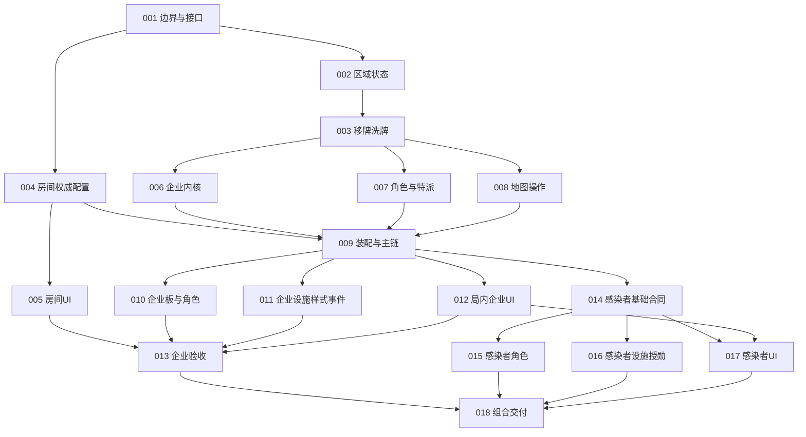

# 企业扩与感染者基础实装提示词

> **2026-10-11当前入口：** 按用户最新决定执行[整局健康与覆盖优先级](整局健康与覆盖优先级-执行合同.md)：每模式先完整一局，随后按实际未覆盖内容调整合法选择优先级，数局累计；整局链健康与内容覆盖、驱动故障、人工UI分列，不再逐能力独立证明或固定六局。测试不强阻塞的[企业科室正文迁移](企业科室正文迁移-并行实施合同.md)已并行放行。仅构建短暂协调停写，固定Player快照跑局时继续源码开发。实时进度见[执行协调台账](执行协调台账.md)顶部；下列日期条目均为历史，不构成当前冻结、暂停或运行指令。

> **2026-10-10 19:26当前入口：**企业v10第二次实局又停第6回合，新增Covered事件0；先按[确认接收与同步诊断实施边界](确认接收与同步诊断-实施边界.md)补完整接收/Apply/Initial/清等待证据和小型复现，本批不自动第三次整局。下方18:15进展为前一阶段，基础成功1局、正式验收0/6及其他未完成项保持。

> **2026-10-10执行协调已启动：**六个执行者及首批边界见[执行协调台账](执行协调台账.md)。EXP-018采用内部程序触发与外部真实点击两种完整对局方式，以内容覆盖表决定少量必要补验，不再机械要求重复全部历史测试。协调者只写文档和派发，不直接改代码；原任务交付状态继续与追加工作分开记录。

> **2026-10-10 18:15当前进展：**企业内部v9在第6回合无进展退出，三端实际码1/1/1，感染者与外部未启动。确认通知缺口已按[独占运行关口](付款接线收口与运行关口.md)分给共享运输端和组合驱动端，必要验证/统一冻结后直接复验企业。基础真实八回合成功1局、正式验收0/6及业务证明0/171保持；审计合同缺项与累计恢复静态疑点分别保留，不能混作同一种失败。正文迁移仍未完成，无新用户规则/UI待决。

> **首轮交接快照：**[后续实施与验收交接](后续实施与验收交接.md)与[静态核验](执行记录/后续规划核验-20261010.json)记录开始协调前的“018未开始、正式登记缺失”等事实，不代替上面的最新进展。下方历史排程及准备稿中“由原EXP任务实施”“先收口全部bug与性能再调度”等建议不作为当前调度依据。

> **2026-10-08 素材入口更新：**UI 选材唯一入口为[可用 UI 素材](../../游城拓荒/可用UI素材/README.md)，先读[用途索引](../../游城拓荒/可用UI素材/素材用途索引.md)和[用途与替换规则](../../游城拓荒/可用UI素材/文档/用途与替换规则.md)。原 `游城拓荒/UI素材` 为受限档案；本文或历史记录中的旧路径、原包名、脚本入口均不构成访问授权。找不到对应用途时记录并反馈具体缺口，不得跨用途套图、回捞旧包或自行制作替代图。

2026-10-06界面返工实施：已按[返工清单](10-局内明细内容与条目返工清单.md)落实玩家有效非快速效果/容纳区、完整文案及来源去重；企业、地图、卡区、快速授勋回原入口。保留条目原高度76和正文31，溢出时只同步缩小两个字号。企业合作已按UI素材说明改回原图标、0—5列头、同级组合色标记及独立灰槽。此次串行修改必要源资产，未覆盖场景或运行生成器。当前测试、截图与交付范围见[本轮执行记录](执行记录/局内企业与持续区域界面-执行记录.md)；013/018仍按其最终冻结版本验收，不沿用旧画面结论。

2026-10-05感染者设施样式授勋交付：EXP-016已实装6设施实体、3样式、4授勋的独立内容及通用生命周期。规定EditMode 41/41通过，扩大回归9夹具336项通过；前置企业公司夹具修复后Mono补充43/43通过，正式Unity补跑仍等待新锁文件清理。正式pack/切片登记、真实杰西卡联合与组合视觉验收归018，本项未修改HUD资产。详见[执行记录](G:/NoMadCity/prompt/企业扩与感染者基础实装/执行记录/感染者设施样式与授勋-执行记录.md)。

2026-10-05感染者界面接线交付：EXP-017已接入当前Use底栏结算、绑定报价、新盖槽/流形实体、公司整对区控、地图token和授勋/重复进度路由。规定PlayMode 9/9、既有企业界面回归15/15、相关EditMode 92/92通过，三/四人场景保持原哈希，未运行生成器。该结论只覆盖接口与实际资产接线；真实015/016卡牌、锁定期限、联机恢复及完整视觉矩阵仍归018。受控投影与生产处理器证据分列于[感染者界面执行记录](G:/NoMadCity/prompt/企业扩与感染者基础实装/执行记录/感染者局内界面整合-执行记录.md)。

2026-10-06企业整合交付：EXP-013企业功能整合验收通过。33正式定义、77能力全部有当前执行证据；完整EditMode 2012/2012、相关PlayMode 36/36＋终局恢复1/1、Development构建通过。同一冻结构建的基础/企业2/3/4人六组、18个独立Player完成八回合，1895份投影审计和六次重连通过；36张实际画面已逐张检查。房间静态说明及终局背景提示仍有展示遗留，已按资产归属交接；不宣称视觉无遗留。正式清单交018，企业HUD交017/018；感染者及企业家门禁保留，不据本项宣布NMC-015完成。详见[企业整合报告](G:/NoMadCity/prompt/企业扩与感染者基础实装/执行记录/企业扩整合验收-执行记录.md)。下方较早的“待013登记/未开放企业门禁/企业整合进行中”属于历史状态。

2026-10-05感染者前置交付：EXP-014已完成三企业、公司/合约、8/5/5装配与唯一主链增量，规定定向43/43及相关10夹具450/450通过。015/016可依交付合同继续；真实阿米娅/干员/流形/设施/授勋的交叉验收与正式感染者登记仍归018，当前生产组合保持content_not_ready。详见[感染者装配企业与公司规则执行记录](G:/NoMadCity/prompt/企业扩与感染者基础实装/执行记录/感染者装配企业与公司规则-执行记录.md)。

2026-10-05最新接续：010玩家合同纠正及剩余13能力已全部实施，66份Lua、22份有效定义齐备；指定内容111/111、受影响底座350/350通过，均0失败/跳过、Unity退出0。正式企业组合、素材/配方登记及综合验收归013，当前未开放门禁。详见[最新执行记录](G:/NoMadCity/prompt/企业扩与感染者基础实装/执行记录/企业板科室与角色内容-执行记录.md)。下方010行及接续状态已更新，011沿用原复核结论。

2026-10-05界面回归收口：012原五条失败已修复，界面测试20/20、原扩大回归同组187/187通过，均0失败/跳过、Unity退出0。本轮只修正测试夹具、过时入口及断言并同步文档，生产代码、场景及预制体未改。详见[界面执行记录](G:/NoMadCity/prompt/企业扩与感染者基础实装/执行记录/局内企业与持续区域界面-执行记录.md)。

## 2026-10-04晚间完成情况复核（历史，010、012已更新）

本次按用户要求检查010—012，实际读取三份提示词、执行记录、登记清单、当前源码及XML，抽查012的直接特效和持续区截图；没有修改游戏源码、测试断言、正式清单或界面资产，没有调用Rebuild。

| 任务 | 复核结论 | 证据与未完项 |
| --- | --- | --- |
| EXP-010 | 本项内容实现及固定定向验收完成（2026-10-05更新），正式登记待013 | 66份真实Lua、22份有效JSON；原13能力及10份定义缺口已关闭。指定fixture111/111、受影响底座350/350通过、0失败/跳过；完整组合/素材/配方仍由013合入验收 |
| EXP-011 | 本项已完成，正式登记待013 | 已解析最终64/64与相关299/299的原始XML；11份JSON及11份Lua当前SHA256均与交付清单一致，meta齐备，事件替换方向正确。本次未重复运行该通过范围 |
| EXP-012 | 本项界面接线及合同验收已交付；原五项界面回归已收口（2026-10-05更新） | 本次PresentationSelectionControllerTests为20/20，原扩大回归同组187/187，0失败/跳过、Unity退出0；修复夹具依赖、视口及过时入口/断言，未改生产或资产。此前规定PlayMode15/15及页面9/9保留原证据，本轮未重复运行；详见[执行记录](G:/NoMadCity/prompt/企业扩与感染者基础实装/执行记录/局内企业与持续区域界面-执行记录.md) |

本次正式复测[XML](G:/NoMadCity/Logs/ExpansionValidation/EnterpriseDeliveryReview/20261004/editmode-20261004_203527.xml)、[Unity日志](G:/NoMadCity/Logs/ExpansionValidation/EnterpriseDeliveryReview/20261004/editmode-20261004_203527.log)：合计88项，81通过、7失败、0跳过；Unity以测试失败码2正常结束，runner退出1。没有Unity进程/项目锁残留，失败来自上述用例，不是Temp锁阻塞。

010玩家合同及原13缺式已按审阅和用户授权完成，区域/供应/地图/付款/持续合同已实装并正式验证，见[接口核验](G:/NoMadCity/prompt/企业扩与感染者基础实装/执行记录/接口核验记录.md)。多萝西收尾/实际离场、异客显式0…min(4,实时库存)数量选择及整次费用最多2替代均已覆盖。011保留交付，013统一登记素材/内容/配方并验收完整组合。012原五项失败已于2026-10-05修复，20/20及同组187/187通过，未重建用户资产；正式组合仍须013登记及验收，门禁不因本次回归开放。

**2026-10-04局内界面接续（历史）：** EXP-012已完成企业/科室/特派、实例手弃盖持续与牌载区、六槽供应及通用结算槽接线。实际两场景合同验证规定PlayMode 15/15、相关页面9/9、相关EditMode 137/137通过；当时较广回归5条界面断言未通过，该历史未完已于2026-10-05收口，完整范围及证据见[固定执行记录](G:/NoMadCity/prompt/企业扩与感染者基础实装/执行记录/局内企业与持续区域界面-执行记录.md)。场景保持输入哈希，没有运行Rebuild；HUD源的局部接线与序列化文案已交接017，本项停止并行修改同一资产。截图为合同数据，正式企业内容完整流程归013，感染者真实内容、公司/token与结算显示按017及后继接续。未自动执行后继任务或开放正式组合门禁。

**2026-10-04最新接续：** EXP-009共享内容装配、企业开局/人数变体、R01保留上限及唯一回合主链已完成。固定Unity定向37/37、最终相关回归339/339，均0失败/跳过、退出0；三/四人真实命令八回合到终局，本轮覆盖的旧基础回归失败已关闭。场景/预制体与输入基线一致，用户原有修改保留。010、011、012、014可按依赖接续；正式企业内容/可游玩归013，感染者正式组合与联机/构建/视觉归后继验收，当前门禁未开放。详见[执行记录](G:/NoMadCity/prompt/企业扩与感染者基础实装/执行记录/内容装配与开局回合主链-执行记录.md)、[接入合同](G:/NoMadCity/prompt/企业扩与感染者基础实装/执行记录/内容装配与主链接入合同.md)和[最终XML](G:/NoMadCity/Logs/ExpansionValidation/SetupFlowRegression/20261004_050332/editmode-20261004_050332.xml)。未自动执行后继任务。

**2026-10-03前置补测记录：** 已按用户审阅纠正R01，初始8张基础角色（含阿米娅）保留5张、3张秘密回盒，入场后基础角色上限5。EXP-006/007/008的正式Unity定向补测已完成：52/52、57/57、36/36，共145/145，0失败/跳过；退出后无Unity进程和项目锁。当时下一步为009；其2026-10-04交付见上方最新接续。详见[基础角色保留规则纠正与实装接续](基础角色保留规则纠正与实装接续.md)及[本次XML](G:/NoMadCity/Logs/ExpansionValidation/CoreDomainAcceptance/20261003-rule-review/editmode-20261003_155923.xml)。前置补测未改游戏代码或资产，不代表NMC或扩展整体验收完成。

2026-10-02审阅，2026-10-03完成EXP-001及EXP-002区域底座。状态：**生产边界与接口定稿、区域物品状态底座及其定向测试已完成；正式扩展开局和后继业务仍须按各任务交付接入**。002定向40项通过，附加旧角色回归4项失败已登记；004配置增量在当前工作区存在，本项不替代004验收。交付：[生产边界执行记录](G:/NoMadCity/prompt/企业扩与感染者基础实装/执行记录/生产边界与接口定稿-执行记录.md)、[区域物品执行记录](G:/NoMadCity/prompt/企业扩与感染者基础实装/执行记录/区域物品与状态底座-执行记录.md)、[接口核验记录](G:/NoMadCity/prompt/企业扩与感染者基础实装/执行记录/接口核验记录.md)、[共享文件合入记录](G:/NoMadCity/prompt/企业扩与感染者基础实装/执行记录/共享文件合入记录.md)。不改变NMC-014A/NMC-015的整体验收状态。

2026-10-03补充：EXP-004房间配置与权威同步已完成，最终定向39/39、相关回归126/126通过。冻结配置已进入实际三/四人场景并完成归档恢复；005和009可消费已接通接口。当前企业/感染者、二人完整变体及企业家模式仍受生产能力门禁限制，双Steam客户端和视觉验收未执行。[房间执行记录](G:/NoMadCity/prompt/企业扩与感染者基础实装/执行记录/房间配置与权威同步-执行记录.md)。

## 目标与范围

2026-10-03补充：EXP-007角色生命周期、真实多盖牌槽、普通特派、独立直接换牌/转交及当前使用双发插入已实装。补充合同烟测57/57、移牌补充回归48/48通过；此前正式Unity定向命令被陈旧锁阻挡；本次补测57/57通过，规定XML已补齐。没有开放感染者牌池或修改局内HUD。详见[角色执行记录](G:/NoMadCity/prompt/企业扩与感染者基础实装/执行记录/角色生命周期与特派-执行记录.md)。

2026-10-03地图操作补充：EXP-008生产实现及受管理程序集补充验证已完成，定向36项、相关133项通过；此前指定Unity命令因陈旧UnityLockfile阻塞；本次补测36/36通过，规定XML已补齐。地图内核可供009/010/014/015接入，正式开局、额外采集执行、锁定/合约内容及整体验收继续按原归属处理。详见[地图执行记录](G:/NoMadCity/prompt/企业扩与感染者基础实装/执行记录/影响力公路与地图操作域-执行记录.md)。

在现有Lua Effect树、Host权威及当前Unity资产上，完整接入企业扩、非企业家感染者和Room UI v1.1房间配置。目标组合为基础、基础＋企业、基础＋企业＋感染者；覆盖2/3/4人规则，地图选择与人数规则分别保存。企业家能力、抉择、帮派、图纸、层叠设施和特殊计分不在本组实现范围；其房间模式保留独立配置维度，本阶段不可启动尚未实现的企业家模式。

先读[审阅结论与待处理项](01-审阅结论与待处理项.md)、[共同执行约束](00-共同执行约束.md)、[房间UI接入合同](02-房间UI接入合同.md)和[内容与验收覆盖矩阵](03-内容与验收覆盖矩阵.md)，再指派对应任务。原始资料在[企业规格](../../游城拓荒/企业扩/卡面效果与Effect式.md)、[感染者规格](../../游城拓荒/感染者扩/卡面效果与Effect式.md)、[流程](../../游城拓荒/可选扩展包游戏流程变化.md)、[共同改动清单](../../游城拓荒/可选扩展包实装改动清单.md)。

## 严格执行合同

所有执行者必须读取当前任务的完整内容，包括末尾“逐项执行卡”；不能只拿README的任务标题开工。

| 合同 | 内容 |
| --- | --- |
| [04 文件路径与归属](04-路径索引与实施文件归属.md) | 已核实源文件、指定新增文件、共享文件唯一负责人 |
| [05 状态与命名](05-状态模型与命名合同.md) | 类型/变量/区域ID、唯一事实源、生命周期字段及禁止任务号命名 |
| [06 Effect接口](06-Effect接口与提交合同.md) | 现有执行器签名、新API参数/typeId/返回值/错误码/恢复阶段 |
| [07 内容定义](07-内容定义与注册合同.md) | 62行具体定义加公路、精确文件命名、schema/配方/replaces/能力ID |
| [08 房间与局内UI接口](08-房间与局内UI接口合同.md) | 配置/座位/请求/服务签名、结算槽投影/命令、实际资产 |
| [09 检查与交付](09-执行检查与交付模板.md) | 实施顺序、测试命令、命名检查、报告固定地址与栏目 |

**严禁用任务序号命名代码、脚本、测试、协议ID、Unity物体、资产、日志或工具。**任务编号仅是本文排程标签；执行产物必须用业务名称。接口核验任务负责验证固定合同是否兼容，不授权后续任务自由改名。

## 任务与硬依赖

依赖指前置合同和交付已完成并可读取；只写过设计、只存在类型名、历史测试通过，均不算前置完成。表中编号均为本组`EXP-xxx`，不延用NMC编号。

| 任务 | 实施提示词 | 硬依赖 | 主要产物 |
| --- | --- | --- | --- |
| EXP-001 | [生产边界与接口定稿](EXP-001-生产边界与接口定稿.md) | 无 | 当前调用审计、接口/ID/版本合同、风险与文件归属 |
| EXP-002 | [区域物品与状态底座](EXP-002-区域物品与状态底座.md) | 001 | 四根区域、稳定实例、物理类型与操作域、投影/迁移 |
| EXP-003 | [移牌洗牌与供应原语](EXP-003-移牌洗牌与供应原语.md) | 002 | 通用转移、洗牌、稳定供应槽、有界次数组合、旧API显式适配 |
| EXP-004 | [房间配置与权威同步](EXP-004-房间配置与权威同步.md) | 001 | 地图/扩展/规则模式、座位、准备及启动快照 |
| EXP-005 | [房间界面素材与接线](EXP-005-房间界面素材与接线.md) | 004 | Room v1.1实际房间资产与配置交互 |
| EXP-006 | [企业等级科室与特效内核](EXP-006-企业等级科室与特效内核.md) | 003 | 升级/到达奖励、共享科室、特效选择与冻结 |
| EXP-007 | [角色生命周期与特派](EXP-007-角色生命周期与特派.md) | 003 | 普通/持续/一次性、牌载区、普通特派、双发与新盖牌合同 |
| EXP-008 | [影响力公路与地图操作域](EXP-008-影响力公路与地图操作域.md) | 003 | 真实离场、替换、主体过滤、公路、token拓扑接口 |
| EXP-009 | [内容装配与开局回合主链](EXP-009-内容装配与开局回合主链.md) | 004、006、007、008 | 按局装配、入场、人数差异、时点及结算主干 |
| EXP-010 | [企业板科室与角色内容](EXP-010-企业板科室与角色内容.md) | 009 | 8企业、3科室、8干员、山和玛恩纳 |
| EXP-011 | [企业设施样式与事件内容](EXP-011-企业设施样式与事件内容.md) | 009 | 3办事处、6样式、2替换事件及准确素材绑定 |
| EXP-012 | [局内企业与持续区域界面](EXP-012-局内企业与持续区域界面.md) | 009 | 企业/科室/特派/持续区与现有交互页面接线 |
| EXP-013 | [企业扩整合验收](EXP-013-企业扩整合验收.md) | 005、010、011、012 | 企业功能验收交付：2012项EditMode、37项相关PlayMode、六组真实网络通过；展示遗留按报告交接 |
| EXP-014 | [感染者装配企业与公司规则](EXP-014-感染者装配企业与公司规则.md) | 009 | 感染者设置/回合增量、3企业、公司与合约（前置交付完成，43/43＋450/450） |
| EXP-015 | [感染者角色流形与结算插入](EXP-015-感染者角色流形与结算插入.md) | 014 | 9角色、3流形、锁定/永久token、底栏结算请求 |
| EXP-016 | [感染者设施样式与授勋](EXP-016-感染者设施样式与授勋.md) | 014 | 6普通设施实体、3样式、4授勋生命周期 |
| EXP-017 | [感染者局内界面整合](EXP-017-感染者局内界面整合.md) | 012、014 | 新盖牌/流形/公司/token/结算槽真实投影与交互 |
| EXP-018 | [组合联机恢复与交付验收](EXP-018-组合联机恢复与交付验收.md) | 013、015、016、017 | 感染者正式清单、组合矩阵、联机/恢复/视觉与交付记录 |

## 依赖图

## 可并行安排

| 波次 | 可同时推进 | 必须串行的收口 |
| --- | --- | --- |
| A | 001完成后，002与004分别推进 | 001核验05—08固定合同、生产入口及文件负责人 |
| B | 003与005可并行（各自前置完成后） | 005只操作房间资产，不碰局内HUD |
| C | 006、007、008可并行 | 宿主构造器、GameState/DTO/克隆文件由集成人按接口增量串行合入 |
| D | 009完成后，010、011、012、014可并行 | 正式pack/素材总清单暂由013管理；014登记感染者内容待018收口 |
| E | 015、016、017可并行，013同时完成企业验收 | 017等待012交接HUD资产；015只产出结算请求/投影，不修改HUD资产 |
| F | 018统一整合与交付 | 正式清单、主链、序列化版本、Unity完整测试和Player构建串行 |

并行表示依赖许可，不表示可以同时改同一文件。共享的`GameState`、DTO、克隆/投影、`MoonSharpLuaRuntimeHost`、注册器、`pack.json`、素材总清单、场景和Prefab设单一负责人；其他任务交付增量建议，由负责人串行合入后才能验收。010/011/015/016分别编写独立定义与Lua文件，并提交待登记列表；不多人抢写同一清单。不得同时运行多个Unity进程使用同一checkout。

### 前置交付与最终集成验收分开判定

禁止为了满足前置任务而等待它自己的后继，形成隐含循环：

| 任务 | 本任务必须完成后才能交给后继 | 必须留给内容齐备后的集成验收 |
| --- | --- | --- |
| 009 | 实际装配/主链/配方接口可执行；使用明确标记的测试定义验证人数与时序；基础局真实可运行 | 010/011企业真实内容完整开局由013验收；感染者全部真实内容由018验收 |
| 014 | 三企业/公司规则和感染者配方完成；使用测试目录中行为完整的角色/奖励定义验证所需接口；缺正式内容时生产组合仍拒绝启动 | 无罗德岛时实际阿米娅特派、全部16干员/3流形/6设施/4授勋一起开局，需015/016交付，由018验收 |
| 017 | 按007/014固定DTO接好实际资产和命令，受控投影验证权限、引用、显示及提交；无来源数据不显示假可用 | 015/016真实内容驱动的阿米娅/杰西卡/授勋完整交互由018验收 |

这些后置证据在报告内写明“集成待验—由013/018执行”，不能标记已通过；也不阻断已达到上列合同交付条件的后继启动。测试定义只放指定测试目录，必须能真实执行所测子树，不得用空脚本、生产占位牌或硬编码结果骗过能力校验。013/018最终交付前逐项清零，不能把它们永久留作“后续完善”。

## 交付与执行方法

2026-10-09 当前追加修订：[佣兵入场与玩家牌区查看](执行记录/佣兵入场与玩家牌区查看修订.md)。包含替换影响力的地图 UI 映射、头像联动城市与三牌区、匿名实物卡背合同及城市标题普通字体；按文中单一文件负责人实施与有限验收。

2026-10-09 新增准备：[结算插入按钮：Lua 定义与实装准备](结算插入按钮-Lua定义与实装准备.md)、[素材映射（跟随用户最新选图，焦点排除）](结算插入按钮-素材映射.json)。这两份是后续实施合同与选材记录，新按钮及新 Lua API 尚未实装；不要据此运行生成器或覆盖现有 HUD。本轮 bug 修复与当前验收状态见[局内交互与持续效果修订](执行记录/局内交互与持续效果修订.md)。

2026-10-09 玩法文案准备：[局内玩法文案与图标转译](局内玩法文案与图标转译-实装准备.md)、[结算区域13个按钮的图标与文字](结算区域按钮-图标与文字清单.md)。前者定义 Lua/JSON 文案、统一图标转译、企业组合详情、选择/次数式与底栏的迁移接口及任务依赖；后者逐来源指定显示文字与图形。另有[正文图标素材映射](正文图标-素材映射.json)，登记用户指定 icon/自制icon 的26张图，分数使用图标内叠加数字。均未实装，固定 UI 标题/按钮/框体文字保留原资产所有权。

每次指派提供当前任务提示词的完整绝对路径，例如`G:\NoMadCity\prompt\企业扩与感染者基础实装\EXP-002-区域物品与状态底座.md`，要求执行者完整读取该文档的“逐项执行卡”和全部必读地址，按05—08固定接口/字段实现，按09填写指定报告。2026-10-03实际交付：001审计、002区域底座、004房间权威配置已完成；003移牌/洗牌/供应/Repeat合同交付完成，定向48/48通过，见[移牌执行记录](G:/NoMadCity/prompt/企业扩与感染者基础实装/执行记录/移牌洗牌与供应原语-执行记录.md)。005交付见其房间界面报告；006/007/008生产接口已交付，正式Unity定向共145/145通过。2026-10-04的009交付37/37及339/339通过；后继入口为010、011、012、014，按各自依赖和接入合同执行。未自动启动后继任务，正式联机/构建/视觉及其他任务未验收项不视为已清零。

执行记录命名`执行记录/任务业务名-执行记录.md`（任务编号只写报告元数据），记录输入版本、修改范围、API变更、卡牌覆盖、测试/视觉/恢复证据和剩余项。任务状态只根据证据更新。013代表企业子集验收，018代表本组全部目标验收；二者均不自动代表NMC-015或企业家模式完成。

2026-10-03企业内核进展：EXP-006指定模块及共享API/恢复/候选增量已实装，企业52项及Lua宿主16项补充Mono烟测通过、编译0错误；**2026-10-03正式Unity定向52/52通过，XML已补齐，原锁阻塞关闭**。[企业内核报告](G:/NoMadCity/prompt/企业扩与感染者基础实装/执行记录/企业等级科室与特效内核-执行记录.md)记录实际来源、接口格式、证据与009/010/014交接。没有启用正式企业/感染者或改动场景资产。
